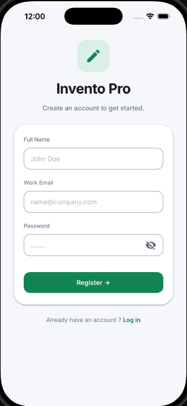
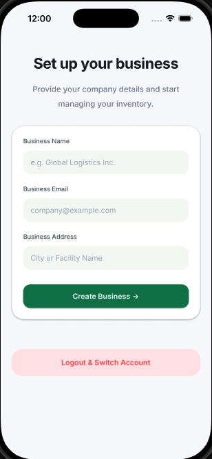
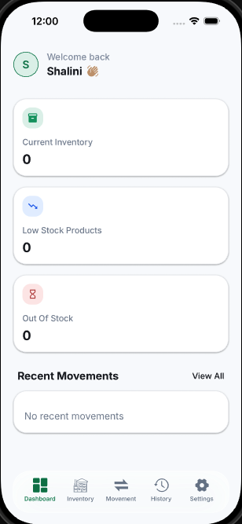
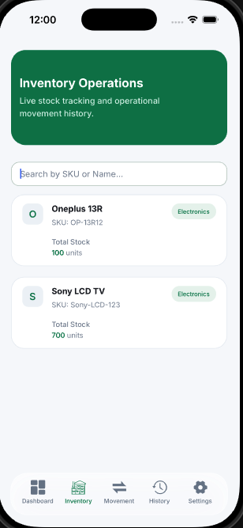
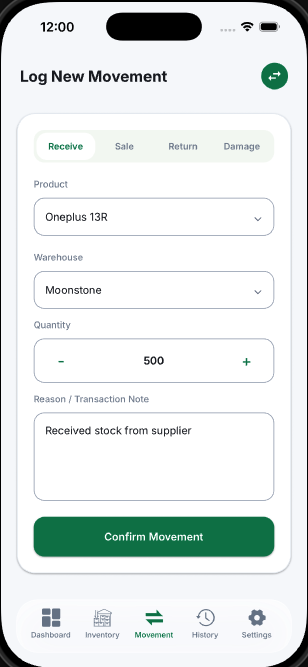
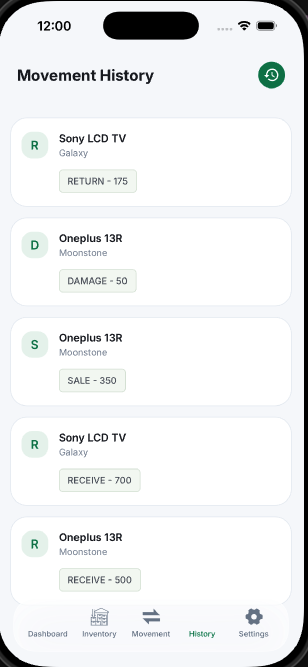
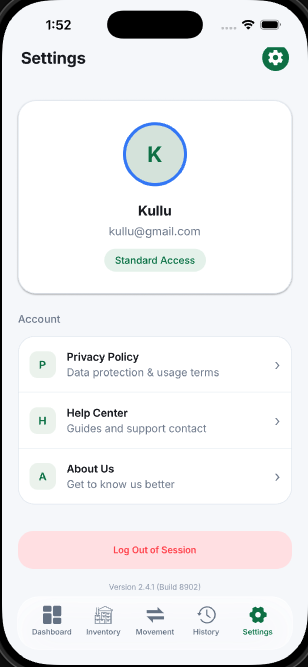
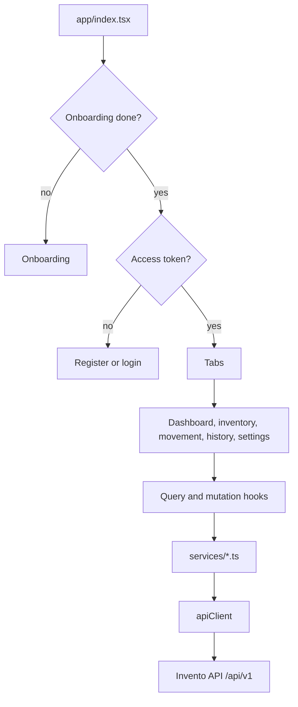

# Invento Pro

Expo app for inventory: onboarding, owner signup, warehouses, products, stock movements, and a dashboard. It talks to the Invento API.

## Project Overview

Invento Pro (`com.rishabh.inventopro`) is a React Native app built with Expo SDK 56 and Expo Router. The display name in `app.json` is Invento Pro.

Opening the app checks onboarding, then sends a signed-in user to the tabs and everyone else to registration. Tabs cover the dashboard, inventory, movement, history, and settings. Owners manage products, categories, warehouses, and employees from settings.

The HTTP client is Axios. Server state uses TanStack Query. The signed-in session uses Zustand. Forms use React Hook Form and Zod.

## Features

- Onboarding slides, then registration and business setup
- Login, session restore, and sign-out
- Dashboard stats and inventory stats
- Inventory list with search
- Stock movements: Receive, Sale, Return, Damage
- Movement history
- Owner screens for products, categories, warehouses, and employees
- Settings links for about, help, privacy policy, and terms

The Invento support page describes employees as able to log movements and view inventory, history, and the dashboard, and owners as the people who manage products, categories, warehouses, and employees.

## Screenshots

### Register



### Set up your business



### Dashboard



### Inventory



### Log a movement



### Movement history



### Settings



## Tech Stack

- Expo SDK 56, Expo Router, React 19.2, React Native 0.85
- TypeScript
- NativeWind and Tailwind CSS 3
- TanStack Query 5
- Zustand, persisted with `expo-secure-store`
- Axios
- Zod 4 and React Hook Form
- `@gorhom/bottom-sheet` for add and edit sheets
- EAS Build (`eas.json`)

## Architecture

Screens live in `app/`. They call hooks in `hooks/query` and `hooks/mutation`, which call services in `services/`. Services use `lib/apiclient.ts`.



### Session

1. Login stores the user, access token, refresh token, and access-token expiry in the Zustand store.
2. Only the refresh token is written to Secure Store (`partialize` in `store/auth.store.ts`).
3. The Axios request interceptor attaches `Authorization: Bearer <access token>` when a token is in memory.
4. A `401` on any call other than login or refresh clears the session, shows "Your session has expired", and replaces the route with `/login`.
5. `hooks/useSessionRefrest.ts` restores a session from the stored refresh token.

### Navigation

`app/index.tsx` waits on onboarding status, then redirects to `/onboarding`, `/(tabs)`, or `/(auth)/register`. The tab layout redirects to `/(auth)/login` when there is no access token.

## Local Setup

```bash
npm install
npx expo start
```

`utils/helper.ts` reads the API base URL from `EXPO_PUBLIC_API_URL` and the Axios client uses it as `baseURL`. Set it to the backend origin plus `/api/v1`, for example:

```bash
export EXPO_PUBLIC_API_URL=http://localhost:8080/api/v1
npx expo start
```

Scripts in `package.json`: `start`, `android`, `ios`, `web`, `prebuild`, `lint`, `format`.

### Environment variables

| Variable | Where | Purpose |
| --- | --- | --- |
| `EXPO_PUBLIC_API_URL` | `utils/helper.ts`, EAS build profiles | Base URL for Axios, including the `/api/v1` prefix. |

`eas.json` sets this for the `development`, `preview`, and `production` profiles. A local `.env` is committed in this repo. `.gitignore` does not ignore `.env`. Keep that file limited to the public API URL.

The API itself needs Postgres and `JWT_SECRET_KEY`. See the `inventory-mgmt-backend` repo.

## Database Design

This app does not ship a database. Inventory, users, and movements are stored by the API. The only data kept on device is the refresh token in Expo Secure Store, plus the in-memory Zustand session.

## API Overview

The app does not expose an API. It calls the Invento backend. Service modules:

| Module | Area |
| --- | --- |
| `services/auth.service.ts` | Register, login, refresh, employees |
| `services/business.service.ts` | Business setup |
| `services/category.service.ts` | Categories |
| `services/product.service.ts` | Products |
| `services/warehouse.service.ts` | Warehouses |
| `services/stock.service.ts` | Movements and history |
| `services/dashboard.service.ts` | Dashboard and inventory stats |

Request and response shapes are in `models/types` and `models/zodSchema`.

## Security

- The access token stays in memory. The refresh token is the persisted field, stored through `expo-secure-store`.
- Axios attaches the bearer token and treats a `401` (except login and refresh) as an expired session.
- `403` shows a permission toast and leaves handling of other status codes to the caller.
- `EXPO_PUBLIC_*` values are bundled into the client. Do not put secrets in `EXPO_PUBLIC_API_URL` or in the committed `.env`.

## Design Decisions

- Expo Router file routes: `(auth)`, `(tabs)`, onboarding, and the owner management screens.
- TanStack Query for server data, with keys in `lib/queryKeys.ts`, so lists can be invalidated after a mutation.
- Zod schemas next to the forms, resolved with `@hookform/resolvers`.
- Bottom sheets for adding and editing categories, products, and warehouses, instead of separate form routes.
- NativeWind for styling, with a light UI (`userInterfaceStyle` is `light` in `app.json`).

## Optimizations

- Query caching avoids refetching every tab focus for data that has not changed. Mutations invalidate the related keys.
- `use-debounce` is a dependency for search input on long lists.
- The persisted auth slice is only the refresh token, so the access token is not written to disk.

## Deployment

EAS profiles in `eas.json`:

| Profile | Distribution | API |
| --- | --- | --- |
| `development` | Internal dev client | Render development host |
| `simulator` | iOS simulator, extends development | Same as development |
| `preview` | Internal | Render development host |
| `production` | Store, `autoIncrement` | Render production host |

```bash
npx eas build --profile preview --platform ios
npx eas build --profile production --platform ios
```

`app.json` sets iOS `buildNumber` to `3`, `ITSAppUsesNonExemptEncryption` to false, and tablets off. Android has an adaptive icon. `submit.production` in `eas.json` is empty, so store submission still needs Apple and Google credentials configured in EAS.

There is no backend in this repo. Point `EXPO_PUBLIC_API_URL` at a deployed API before building.

## Lessons Learned

- Onboarding is a gate in `app/index.tsx`. A null onboarding flag shows a spinner; `false` goes to onboarding; only then does the access token choose tabs vs registration.
- The tab layout checks the access token again. Restoring a session means getting a new access token from the refresh token before those screens render.
- Login and refresh `401`s are not treated as "session expired". Other `401`s clear the store and send the user to `/login`.
- Products, categories, warehouses, and employees are separate routes from the five tabs (`app/products.tsx`, `app/categories.tsx`, `app/warehouses.tsx`, `app/employee.tsx`, `app/add-employee.tsx`).

## License

MIT. Copyright (c) 2026 Rishabh Sharma. See [LICENSE](LICENSE).
